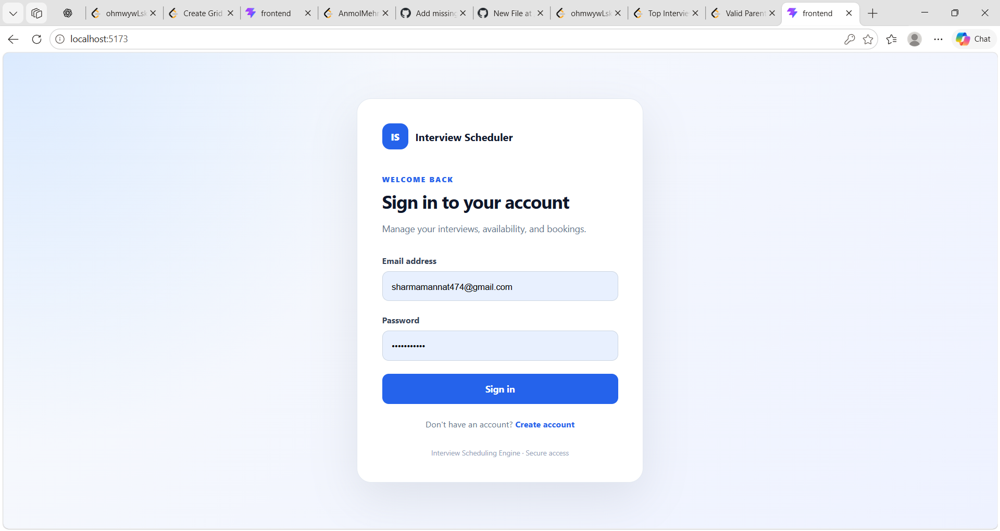
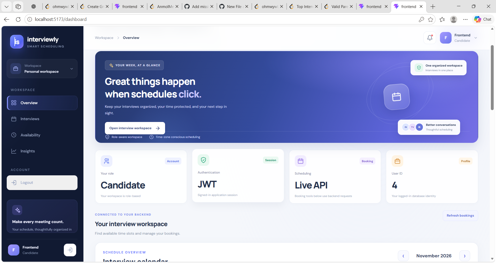
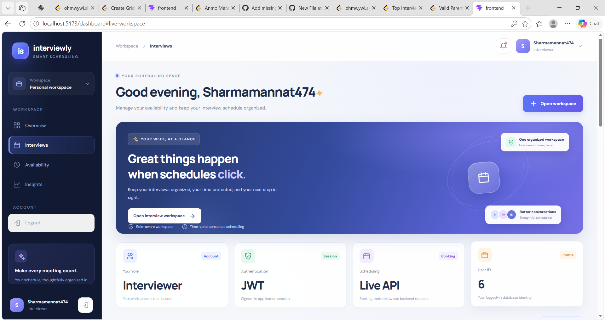

# Interview Scheduling Engine

A full-stack interview scheduling platform that helps **candidates and interviewers manage interview availability, bookings, and schedules** through a secure web application.

Built with **Java, Spring Boot, React, PostgreSQL, JWT Authentication, and Docker**.

---

## 🚀 Features

### 🔐 Authentication & Authorization
- Candidate and interviewer registration
- Secure login using JWT authentication
- Role-based access control
- Protected APIs using Spring Security
- Password encryption
- Interviewer invite-code based registration

### 👤 Candidate Features
- Candidate registration and login
- View available interview slots
- Book an available interview slot
- View scheduled interviews
- Manage interview-related information

### 👨‍💼 Interviewer Features
- Interviewer registration using invite code
- Secure interviewer login
- Set interviewer availability
- View available slots
- Manage interview bookings
- View scheduled interviews

### 📅 Interview Scheduling
- Availability management
- Interview slot booking
- Prevention of conflicting bookings
- Candidate/interviewer scheduling workflow
- Time-zone aware scheduling

### 🐳 Docker Support
- Dockerized Spring Boot backend
- PostgreSQL container using Docker Compose
- Environment-based configuration
- Easy local setup using Docker

---

## 🛠️ Tech Stack

### Backend
- Java 17
- Spring Boot
- Spring Security
- Spring Data JPA
- Hibernate
- Maven
- JWT

### Frontend
- React
- JavaScript
- CSS
- Axios
- React-based UI

### Database
- PostgreSQL

### DevOps / Tools
- Docker
- Docker Compose
- Git
- GitHub
- IntelliJ IDEA
- Postman

---

## 🏗️ Architecture

```text
                    ┌─────────────────────┐
                    │      React UI       │
                    │     Frontend        │
                    └──────────┬──────────┘
                               │
                               │ REST API
                               ▼
                    ┌─────────────────────┐
                    │    Spring Boot      │
                    │      Backend        │
                    │                     │
                    │  Spring Security    │
                    │       + JWT         │
                    └──────────┬──────────┘
                               │
                               │ JPA / Hibernate
                               ▼
                    ┌─────────────────────┐
                    │     PostgreSQL      │
                    │      Database       │
                    └─────────────────────┘
```

---

## 📂 Project Structure

```text
interview-scheduling-engine/
│
├── frontend/
│   └── React frontend
│
├── src/
│   └── main/
│       ├── java/
│       │   └── com.hire.interview/
│       │       ├── controller/
│       │       ├── service/
│       │       ├── repository/
│       │       ├── entity/
│       │       ├── dto/
│       │       ├── security/
│       │       └── InterviewApplication.java
│       │
│       └── resources/
│           └── application.yaml
│
├── Candidate.png
├── Interviewer.png
├── Loginn.png
├── Dockerfile
├── compose.yaml
├── pom.xml
├── mvnw
├── mvnw.cmd
└── .gitignore
```

---

## 🔑 Authentication Flow

The application uses **JWT-based authentication**.

```text
User
 │
 ▼
Login
 │
 ▼
Spring Security
 │
 ▼
Credentials Validation
 │
 ▼
JWT Token Generated
 │
 ▼
Client Stores Token
 │
 ▼
Token Sent With Protected Requests
 │
 ▼
JwtAuthenticationFilter
 │
 ▼
Authorized API Access
```

Protected APIs require a valid JWT token.

---

## 🗄️ Database

The application uses **PostgreSQL** with Spring Data JPA and Hibernate.

Main application data includes:

- Users
- Candidate information
- Interviewer information
- Interview availability
- Interview bookings

Hibernate is configured to automatically update the database schema during development.

---

## 🐳 Running with Docker

### Prerequisites

Install:

- Docker Desktop
- Git
- Java 17
- Maven (optional because Maven Wrapper is included)
- Node.js and npm for frontend development

---

### 1. Clone the repository

```bash
git clone https://github.com/Mannat30/interview-scheduling-engine.git
```

```bash
cd interview-scheduling-engine
```

---

### 2. Configure environment variables

Create a `.env` file in the project root:

```env
POSTGRES_PASSWORD=your_postgres_password
JWT_SECRET=your_jwt_secret
INTERVIEWER_INVITE_CODE=your_interviewer_invite_code
```

> **Never commit `.env` to GitHub.**
>
> The repository `.gitignore` already excludes environment files.

---

### 3. Start the application

```bash
docker compose up --build
```

This starts the required Docker services.

To run in detached mode:

```bash
docker compose up --build -d
```

Check running containers:

```bash
docker compose ps
```

View backend logs:

```bash
docker compose logs backend
```

Stop the containers:

```bash
docker compose down
```

---

## 💻 Running Backend Without Docker

Make sure PostgreSQL is running.

Configure the required environment variables:

```text
POSTGRES_PASSWORD
JWT_SECRET
INTERVIEWER_INVITE_CODE
```

Then run the Spring Boot application from IntelliJ IDEA or using Maven:

```bash
./mvnw spring-boot:run
```

On Windows:

```powershell
.\mvnw.cmd spring-boot:run
```

---

## 🌐 Frontend Setup

Go to the frontend directory:

```bash
cd frontend
```

Install dependencies:

```bash
npm install
```

Start the development server:

```bash
npm run dev
```

The frontend will provide the web interface for candidates and interviewers.

---

## 🔌 API Overview

The backend exposes REST APIs for:

| Module | Purpose |
|---|---|
| Authentication | Registration and login |
| Users | User information and roles |
| Availability | Interviewer availability management |
| Interviews | Interview booking and scheduling |
| Health | Application health monitoring |

Authentication-protected endpoints require:

```http
Authorization: Bearer <JWT_TOKEN>
```

---

## 📸 Screenshots

### Login



### Candidate Dashboard



### Interviewer Dashboard



---

## 🔒 Security

Security features implemented in the application include:

- JWT authentication
- Spring Security
- Password hashing
- Role-based authorization
- Protected REST endpoints
- Environment variables for sensitive configuration
- Interviewer invite-code validation
- Stateless authentication

Sensitive credentials are intentionally excluded from the GitHub repository.

---

## 🐳 Docker Architecture

```text
┌──────────────────────────────┐
│       Docker Compose         │
│                              │
│  ┌────────────────────────┐  │
│  │   Spring Boot Backend  │  │
│  │      Java 17           │  │
│  └────────────┬───────────┘  │
│               │              │
│               │ JDBC         │
│               ▼              │
│  ┌────────────────────────┐  │
│  │      PostgreSQL        │  │
│  │       Database         │  │
│  └────────────────────────┘  │
└──────────────────────────────┘
```

---

## 🧪 Testing

The APIs can be tested using:

- Postman
- Browser
- Frontend application

Typical testing flow:

```text
1. Register user
       ↓
2. Login
       ↓
3. Receive JWT
       ↓
4. Send JWT with protected requests
       ↓
5. Create/View availability
       ↓
6. Book interview
       ↓
7. View scheduled interview
```

---

## 📌 Key Technical Highlights

This project demonstrates practical experience with:

- REST API development
- Spring Boot backend architecture
- Spring Security
- JWT authentication
- Role-based authorization
- PostgreSQL database integration
- Spring Data JPA
- Hibernate
- React frontend development
- Docker containerization
- Docker Compose
- Environment-based configuration
- Git and GitHub workflow

---

## 🔮 Future Improvements

Possible future enhancements include:

- Email notifications for interview bookings
- Calendar integration
- Rescheduling and cancellation workflow
- Automated reminders
- Advanced interviewer matching
- Interview analytics dashboard
- Cloud deployment
- CI/CD pipeline
- Automated testing pipeline

---

## 👩‍💻 Author

**Mannat Sharma**

B.Tech Student | Java Full Stack Developer

GitHub: [Mannat30](https://github.com/Mannat30)

---

## ⭐ Project

If you find this project useful, consider giving the repository a ⭐ on GitHub.
